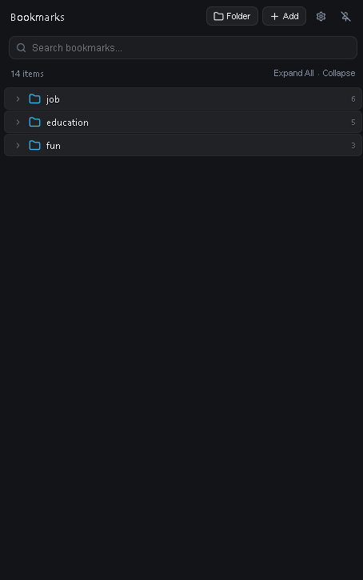

# Sahsi Bookmark - Modern Glassmorphic Bookmark Sidebar

<div align="center">
  
  <p><strong>A Fun Project for Chromium-Based Browsers.</strong></p>
</div>


<p align="center">
  
</p>
---

##  Table of Contents
1. [Important Architectural Notice: Chromium Security Sandbox & New Tab Pages](#-important-architectural-notice-chromium-security-sandbox--new-tab-pages)
2. [Key Features](#-key-features)
3. [Architecture & Technology Stack](#-architecture--technology-stack)
4. [Installation Guide](#-installation-guide)
5. [Keyboard Shortcuts & Usage](#-keyboard-shortcuts--usage)
6. [Testing & Quality Assurance](#-testing--quality-assurance)
7. [Privacy & Offline Security](#-privacy--offline-security)
8. [License](#-license)

---

##  Important Architectural Notice: Chromium Security Sandbox & New Tab Pages

> [!IMPORTANT]
> **Why browser extensions cannot inject DOM elements into `brave://newtab` or `chrome://newtab` without completely taking over and destroying the browser's native start page:**

### The C++ Core Security Restriction
In the Chromium browser core (`src/chrome/browser/extensions/extension_tab_util.cc`), extension content scripts are governed by the internal security check `ExtensionTabUtil::IsAllowedScriptExecutionOnUrl()`.

```cpp
// Chromium C++ Source Reference: extension_tab_util.cc
bool ExtensionTabUtil::IsAllowedScriptExecutionOnUrl(
    const Extension* extension,
    const GURL& url,
    int tab_id) {
  // Disallow script execution on chrome://, chrome-extension://, and brave:// schemes
  if (url.SchemeIs(content::kChromeUIScheme) ||
      url.SchemeIs(kChromeUIUntrustedScheme) ||
      url.SchemeIs("brave")) {
    return false; // Strictly blocked by browser kernel
  }
  return true;
}
```

Because of this kernel-level sandboxing:
- **No browser extension** (including market leaders like *Bookmark Sidebar*) can inject floating `<div>` elements, CSS stylesheets, or hover event listeners into internal browser pages (`brave://newtab`, `chrome://newtab`, `brave://settings`, or the Chrome Web Store).
- The **only way** an extension can show content on the New Tab page is by declaring `"chrome_url_overrides": { "newtab": "..." }` in `manifest.json`.
- However, overriding the New Tab page **completely replaces and crushes** Brave's native New Tab experience — destroying Brave's curated wallpaper photos, sponsored background reward earnings (BAT), custom clock/stat widgets, and top-visited tiles.

### Solution
To respect the user's browser choice and preserve Brave's native wallpapers and widgets untouched, **Sahsi Bookmark provides three unified access vectors**:

1. **Seamless Web Injection:** The edge-sliding sidebar and trigger tab automatically mount inside an isolated Shadow DOM on all regular web pages (`http://`, `https://`, `file://`).
2. **Native Chromium Side Panel:** On restricted internal pages (`brave://newtab`, `chrome://extensions`, `chrome://settings`), click the toolbar icon or open the Chromium/Brave Side Panel (`sidepanel.html`) to access your bookmarks instantly.
3. **Global Shortcut (`Alt + B`):** Toggle the bookmark panel anytime from anywhere with a single keystroke.

---

##  Key Features

### 1. Left-Edge Hover Trigger & Physical Tab
- **Full-Height Continuous Edge (0 – 100vh):** Move your cursor to the leftmost edge anywhere on your screen (top, middle, or bottom) to trigger the sidebar.
- **Anti-Jitter Hysteresis:** Built-in opening/closing debounce timers prevent unwanted micro-toggles when scrolling or glancing near the edge.
- **Floating Edge Tab:** An optional, physical trigger pill button (`.soft-edge-trigger-tab`) docked on the screen edge allows one-click opening without relying solely on edge hovering.
- **Draggable Resizing:** Click and drag the subtle right border to resize the sidebar width anywhere from 260px to 550px.
- **Pin Mode:** Pin the sidebar permanently open while working across wide monitors.

### 2. File-Explorer Tree Organization
- **Top-Level Root Unwrapping:** In standard Chrome bookmarks, items are nested under a redundant `"Bookmarks Bar"` parent folder. Sahsi Bookmark automatically unwraps this layer so your actual working folders (`Directory 1`, `Directory 2`, etc.) appear cleanly at root level, just like Windows File Explorer or macOS Finder.
- **Folder Management:** Create new subfolders, add bookmarks, rename folders, or delete folders with item-count confirmation safety.
- **Folder Properties:** Right-click any bookmark or folder to view exact details including Title, Target URL, Parent Folder path, Item Count, and Date Added.
- **Move to Folder Dialog:** Move any bookmark or folder to any directory in your tree with cycle-detection prevention (a folder cannot be moved into itself or its own subfolder).
- **Favorites Bar:** Pin your most frequently accessed bookmarks to the top quick-launch pill row.

### 3. Context Menu & Drag-and-Drop
- **Rich Context Menu:** Right-click anywhere in empty space or on any item for contextual actions (Open in New Tab, Open in Background Tab, Add Subfolder, Move to Folder, Properties, Delete).
- **Drag & Drop:** Reorder bookmarks and move items across folders with visual drop indicators (`drop-above`, `drop-below`, `drop-into`).
- **Multi-Select & Bulk Actions:** Select multiple bookmarks using checkboxes to perform bulk deletion or bulk relocation in a single click.
- **One-Click Tab Capture:** Add current webpage title and URL directly to any selected destination folder.

### 4. Duplicate Bookmarks Scanner
- Automated scanner detects identical URLs saved across multiple folders.
- Clean duplicates with one click while safely preserving the original bookmark instance.

### 5. Backup, Import & Export
- **One-Click Undo System:** Accidental moves, updates, or deletions trigger an instant floating toast notification with an **Undo** button.
- **Netscape HTML Format:** Export or import standard `bookmarks.html` compatible with all modern browsers (Chrome, Firefox, Safari, Edge, Brave, Opera).
- **JSON Backup:** Full backup of your bookmarks tree and user settings.

---


### Core Technologies
- **Framework:** React 19 + TypeScript
- **Bundler:** Vite 6 (multi-target rollup: content script with inline CSS + extension pages + service worker)
- **DOM Isolation:** Open Shadow DOM (`mode: 'open'`) to guarantee that host webpage CSS rules (Tailwind, Bootstrap, resets) never leak into the sidebar, and sidebar styles never affect the page.
- **Icons:** Custom SVG icon system with zero external font dependencies.
- **Testing:** Playwright End-to-End browser test suite running against real Chromium extension instances.


##  Installation Guide

### Step 1: Clone & Build
```bash
# Clone the repository
git clone https://github.com/your-username/sahsi-bookmark.git
cd sahsi-bookmark

*(Alternatively, you can unpack `sahsi-bookmark-extension.zip` directly.)*

### Step 2: Load into Chromium or Brave
1. Open your browser and navigate to the extensions page:
   - **Google Chrome:** `chrome://extensions`
   - **Brave Browser:** `brave://extensions`
2. Toggle on **Developer mode** in the top-right corner.
3. Click the **Load unpacked** button in the top-left corner.
4. Select the **`dist`** directory inside the project folder.
5. The extension is now active! The bookmark icon will appear in your browser toolbar.

---

##  Keyboard Shortcuts & Usage

| Shortcut | Action |
| :--- | :--- |
| **`Alt + B`** | Toggle bookmarks sidebar open / closed |
| **`Escape`** | Close sidebar (when unpinned) |
| **Left Edge Hover** | Move mouse cursor to far-left edge of screen to open |
| **Middle Click / Ctrl + Click** | Open bookmark in a new background tab |
| **Shift + Click** | Open bookmark in a new active tab |
| **Right Click** | Open context menu for folders or bookmarks |

---

##  Testing & Quality Assurance

Automated End-to-End (E2E) testing is performed with **Playwright** directly loading the extension into Chromium:

```text
Running 9 tests using 1 worker

  ✓ Chrome Extension End-to-End Tests › Should load extension in Chromium, inject Shadow DOM on web page, and respond to hover & shortcut
  ✓ Chrome Extension End-to-End Tests › Should load Side Panel page with full bookmark sidebar
  ✓ Bookmark & Folder Management (File-Explorer Style) › Should create folder, add bookmark, inspect properties, and safely delete
  ✓ New Tab Page & Start Screen Verification › Should load modern New Tab start page and smoothly trigger sliding bookmark sidebar
  ✓ Left Edge Trigger & 50-Cycle Open/Close Stress Test › 50 consecutive open/close cycles and multi-height edge trigger verification
  ✓ Themes & Readability Verification › Should support 4 core themes and maintain text readability
  ✓ Bookmark Logic & Utilities › Cycle detection: should prevent moving a folder into its own subtree
  ✓ Bookmark Logic & Utilities › Netscape HTML bookmark parser should parse valid bookmark file
  ✓ Bookmark Logic & Utilities › Netscape HTML parser should handle malformed or empty HTML gracefully

9 passed (100% success)
```

To run the test suite locally:
```bash
npm test
```

---

##  Privacy & Offline Security

- **100% Local & Offline:** Sahsi Bookmark does not communicate with external analytics, trackers, telemetry servers, or cloud APIs.
- **Zero Third-Party Cookies or Tracking:** Bookmarks stay strictly within your browser's native `chrome.bookmarks` storage.
- **Isolated Execution:** DOM injection occurs strictly within a Shadow Root to guarantee zero interference with website security or data.

---

##  License

MIT License. Free and open source for personal and commercial use.
